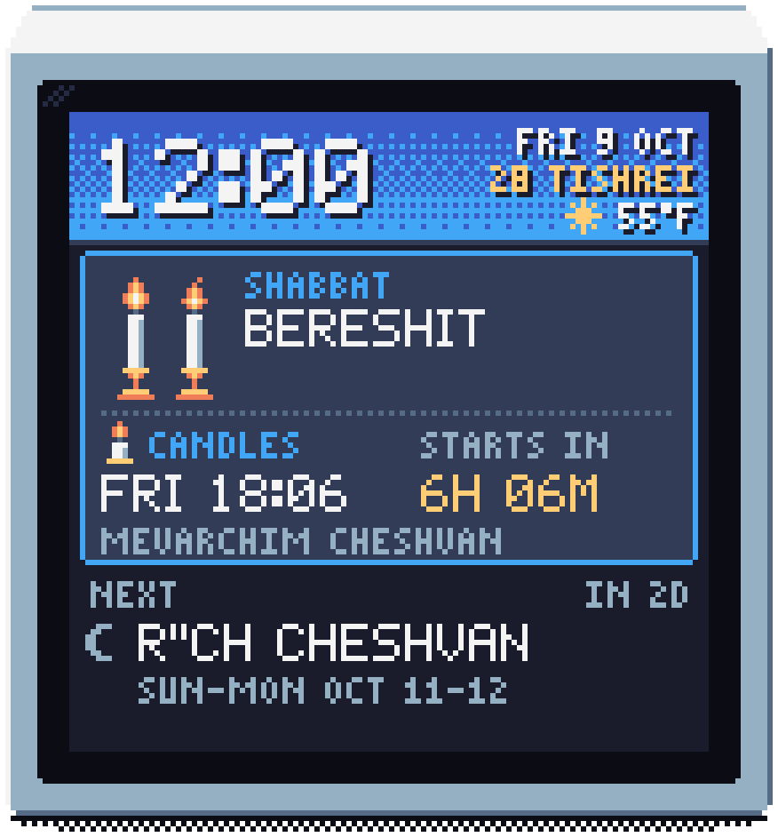

# JewCal: a pixel-art Jewish calendar for the GeekMagic SmallTV

[](https://github.com/roma-glushko/geekmagic-jewcal/actions/workflows/ci.yml)
[](https://geekmagic-jewcal.readthedocs.io/)
[](https://geekmagic-jewcal.readthedocs.io/en/latest/install-ultra/)

<p align="center">
  
</p>

Firmware for the **[GeekMagic SmallTV Ultra](https://geekmagic.cc/products/smalltv-ultra/)** (ESP8266) and
**[SmallTV Pro](https://geekmagic.cc/products/smalltv-pro/)** (ESP32) that shows, for your city:
- Shabbat and Yom Tov with candle-lighting and havdalah times; stacked days are spelled out evening by evening;
- Chol HaMoed, fasts, Rosh Chodesh and the parsha;
- the seasons;
- a screen for each holiday, and the weather.

Times come from [Hebcal.com](https://www.hebcal.com). Settings are at `http://jewcal.local/`.

**📖 [User guide](https://geekmagic-jewcal.readthedocs.io/):** installation, every screen, every setting,
troubleshooting.

## Install

Download your model's zip from the [latest release](https://github.com/roma-glushko/geekmagic-jewcal/releases/latest)
and follow its guide:

| Model | Package | How |
|---|---|---|
| SmallTV **Ultra** (stock firmware "Ultra-V9.x") | `jewcal-ultra-<version>.zip` | [over WiFi, two uploads](https://geekmagic-jewcal.readthedocs.io/en/latest/install-ultra/) |
| SmallTV **Pro** (touch pad on top) | `jewcal-pro-<version>.zip` | [over USB](https://geekmagic-jewcal.readthedocs.io/en/latest/install-pro/) (not yet tested on hardware) |

> ⚠️ Never upload one model's files to the other: the device would not start. SmallTVs with an ESP32-C2 or ESP32-S3
> chip are not supported.

## Development

```
model/       Hebcal URLs, streaming JSON parsing, the calendar model, time zones, Hebrew dates, weather
ui/          120×120 pixel canvas, fonts and sprites, the screens, the screen rotation
app/         settings, the settings web page, the Ultra's main loop
sim/         host tools: fixtures, PNG gallery, the user guide's pictures and pixel font, tz table and C font generators
firmware/    SmallTV Pro: Rust on ESP-IDF
ultra/       SmallTV Ultra: Arduino C++ (src/), the Rust core as a no_std staticlib (core/), the installer (src/loader/)
docs/        the user guide (MkDocs, published on Read the Docs)
```

`model`, `ui` and `app` are `no_std` + `alloc`, so the tests, the simulator and both devices run the same code.

```bash
make check         # what CI runs: rustfmt, clippy, tests (both canvas layouts), no_std builds
make gallery       # render every screen to shots/index.html
make ultra-zip     # SmallTV Ultra images -> dist/   (needs espup's Xtensa toolchain and PlatformIO)
make ultra-check   # the Ultra's limits: image sizes, ROM helpers, static RAM, 3 KB stack budget
make ultra-ota HOST=jewcal.local   # update a running Ultra
make zip           # SmallTV Pro images -> dist/      (needs espup, ldproxy, espflash)
make docs          # build the user guide; make docs-serve for a live preview
make help          # everything else
```

Toolchains:
- **Xtensa Rust:** `cargo install espup --locked && espup install`.
- **PlatformIO:** `python3 -m venv ~/.platformio/penv && ~/.platformio/penv/bin/pip install platformio`.

The Pro build downloads ESP-IDF v5.2.3 on first use. Pro boards with the backlight on GPIO 21:
`make zip FEATURES=backlight-gpio21`. Pin maps are in `firmware/src/main.rs` and `ultra/src/board.h`;
[CLAUDE.md](CLAUDE.md) has the module map and the hardware gotchas.

**CI** ([workflow](.github/workflows/ci.yml)) runs `make check`, both firmware builds and the Ultra's checks on every
push and pull request. It keeps the installable zips and the screen gallery as artifacts of each run. A `v*` tag
publishes a release with both zips.

## Credits and license

- Calendar data: [Hebcal.com](https://www.hebcal.com). Weather: [Open-Meteo.com](https://open-meteo.com). Both CC BY 4.0.
- Palette: [Sweetie 16](https://lospec.com/palette-list/sweetie-16) by GrafxKid.
- SmallTV Pro groundwork: [GeekMagic-Clawdmeter](https://github.com/MyrikLD/GeekMagic-Clawdmeter).
- SmallTV Ultra pin map and two-step install: [smalltv-mod](https://github.com/giovi321/smalltv-mod) and
  [ESPHome](https://devices.esphome.io/devices/geekmagic-ultra/).

[Apache License 2.0](LICENSE); see [NOTICE](NOTICE). Times are as published by Hebcal for the chosen location; follow
your community's customs.
