# JewCal: a pixel-art Jewish calendar for the GeekMagic SmallTV

Firmware for the **GeekMagic SmallTV Pro** (ESP32) and the **SmallTV Ultra** (ESP8266), both with a 240×240
display, that shows what is coming up in the Jewish calendar for your city:
- Shabbat and Yom Tov, with candle-lighting and havdalah times;
- Chol HaMoed, and fasts with their start and end;
- Rosh Chodesh and the weekly parsha;
- the seasons of the year (Elul, the Ten Days of Return, the Omer count, the Three Weeks);
- the weather.

Like the stock firmware, it has a settings website on your network at `http://jewcal.local/`.

Israel and Diaspora schedules are both supported.

Two days of Yom Tov running into Shabbat are spelled out evening by evening. That covers candles before sunset,
candles *after nightfall from an existing flame*, eruv tavshilin, and havdalah only at the very end.

| Main screen | A 3-day chag, evening by evening | During Yom Tov |
|---|---|---|
| 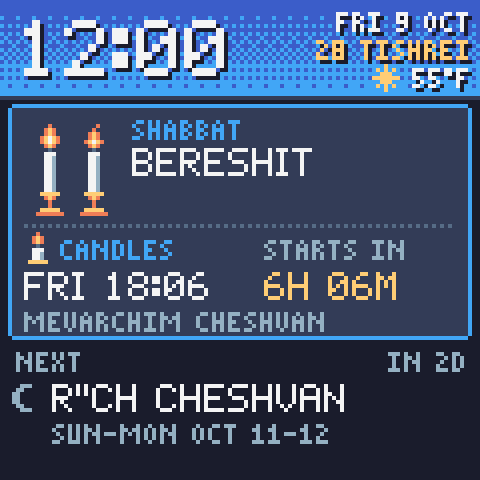 | 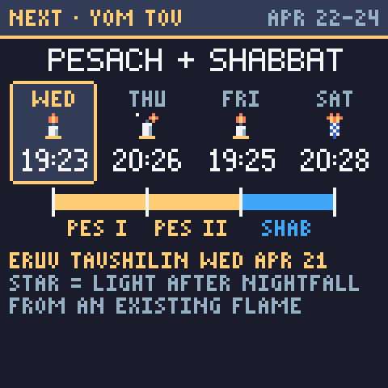 | 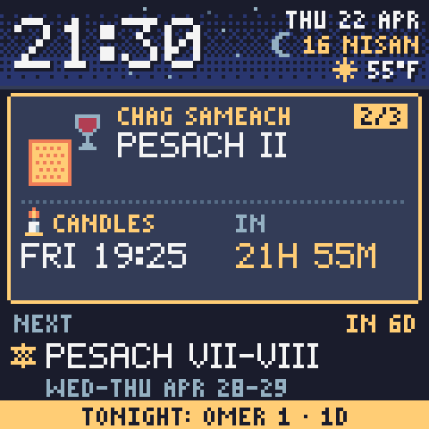 |

| Rosh Hashana | Yom Kippur | Sukkot |
|---|---|---|
|  | 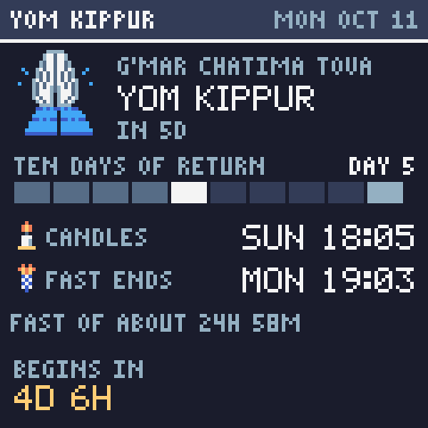 | 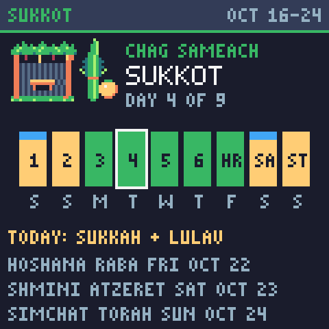 |

| Shavuot | Purim | Pesach |
|---|---|---|
| 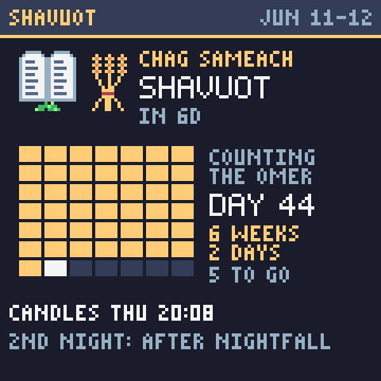 | 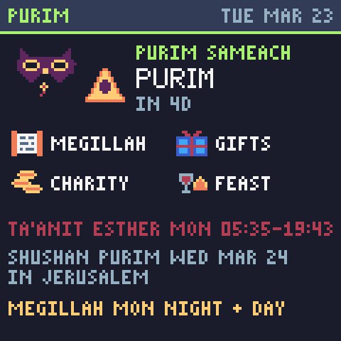 | 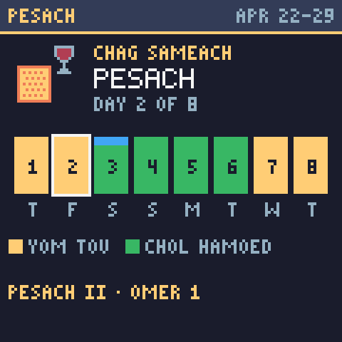 |

| Tisha B'Av | Counting the Omer | Elul |
|---|---|---|
| 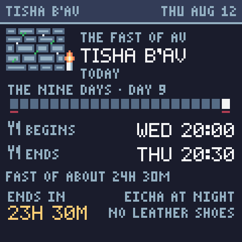 | 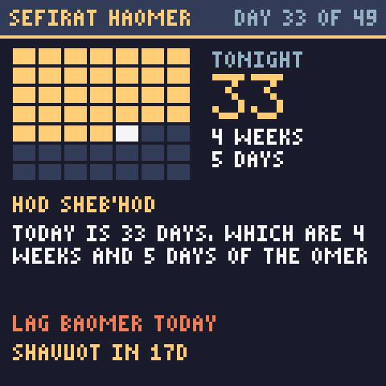 | 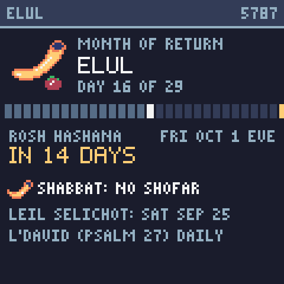 |

| Season ribbon: Elul | Season ribbon: the Omer | Settings address |
|---|---|---|
| 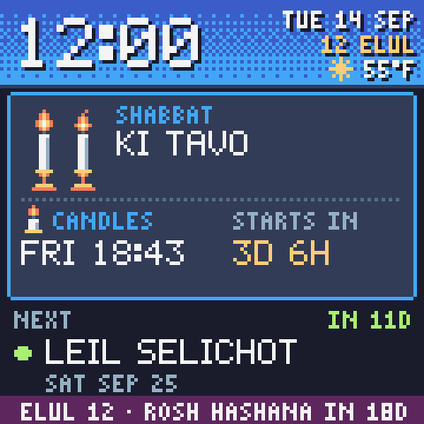 | 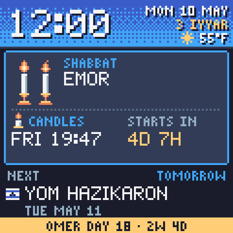 | 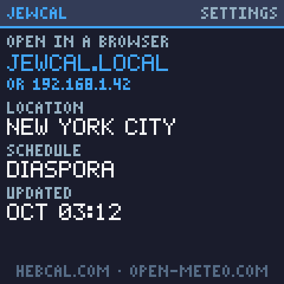 |

| Weather | Upcoming | Hebrew month |
|---|---|---|
| 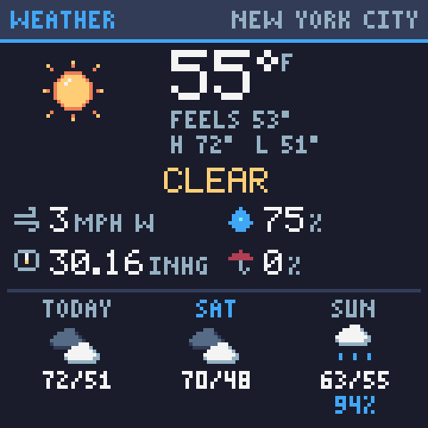 | 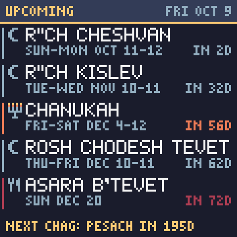 | 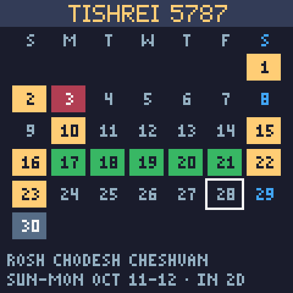 |

| Chanukah | Fast day |
|---|---|
| 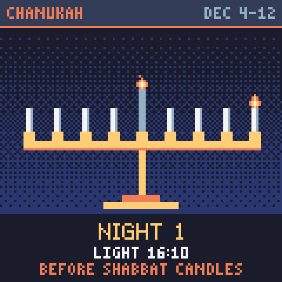 | 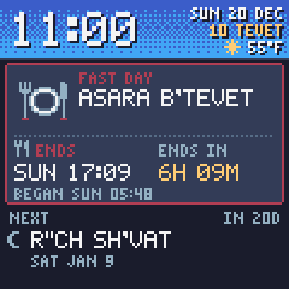 |

All screens are rendered by the host simulator from real Hebcal and Open-Meteo data (see [Development](#development)).

## What it shows

The **main screen** stays up most of the time. It shows:
- **Clock and dates:** the Hebrew date switches at sunset, marked with a small moon.
- **Weather:** the current temperature with a small condition icon.
- **The sky band:** it follows the real sun, so it's blue by day, purple-orange at dusk, and starry at night.
- **A hero card** for whatever is current or next:
  - **Before Shabbat or Yom Tov:** its name (or the parsha), when to light candles, and a countdown. A badge marks multi-day periods (`3 DAYS`), with notes such as *eruv tavshilin today* or *light Chanukah candles first*.
  - **During Shabbat or Yom Tov:** the greeting, which day it is (`DAY 2/3`), and the next evening: candles before sunset, candles after nightfall (★), or havdalah, with a countdown.
  - **During a fast, or when one starts within 24 h:** the begin and end times. A Friday fast ends at Shabbat.
- **A "NEXT" line** with the next holiday, fast or Rosh Chodesh not covered by the hero card.
- **A season ribbon** along the bottom:
  - Elul: `ELUL 12 · ROSH HASHANA IN 18D`.
  - The Ten Days: `TEN DAYS OF RETURN · DAY 5`.
  - The Omer: `OMER DAY 18 · 2W 4D`, which becomes `TONIGHT: OMER 19` after sunset.
  - The Three Weeks and the Nine Days: `THE NINE DAYS · 9 AV IN 3D`.

Every few minutes (configurable) the device shows each **secondary screen** once, then returns to the main one.

Each major holiday gets **its own screen**. It appears a week before the holiday and stays until the holiday
ends at nightfall. Yom Kippur appears right after Rosh Hashana, and Sukkot right after Yom Kippur.
- **Rosh Hashana:** *Shana Tova* and the new year number, one card per day showing whether the shofar is blown (not on Shabbat), candle lighting, and Tzom Gedaliah.
- **Yom Kippur:** praying hands, the Ten Days of Return as a progress bar, and when the fast begins (candles) and ends (havdalah) with its length.
- **Sukkot:** a lulav and etrog, the day strip through Hoshana Raba, Shmini Atzeret and Simchat Torah, and whether there is lulav today (not on Shabbat).
- **Pesach:** the day strip, and the Omer count once it starts.
- **Shavuot:** the Omer as a 7×7 grid filling up towards the 49th day.
- **Purim:** the four mitzvot, Ta'anit Esther with its times, and Shushan Purim.
- **Tisha B'Av** (from 1 Av, the Nine Days): the Western Wall, the Three Weeks as a bar, and when the fast begins and ends. A postponed fast (when 9 Av is Shabbat) is marked.
- **Chanukah:** a menorah with tonight's candles and the lighting time.

Seasons get screens too:
- **Counting the Omer:** the 7×7 grid with Lag BaOmer marked, tonight's count, its sefira (*Hod sheb'Hod*), the counting formula, and days to Lag BaOmer and Shavuot.
- **Elul:** a 29-day bar to Rosh Hashana, whether the shofar is blown this morning (not on Shabbat or Erev Rosh Hashana), Leil Selichot, and Psalm 27.

The other secondary screens are:
- **Weather:** an animated sky (sun, moon, clouds, rain, snow, fog, thunder), temperature and feels-like, today's high and low, wind with direction, humidity, pressure, chance of rain, and a 3-day forecast.
- **Period:** the evenings of the current or next Shabbat/Yom Tov, with times, kinds and notes.
- **Upcoming:** the next five holidays, fasts and Rosh Chodesh, plus the next Yom Tov even if it is months away.
- **Month:** the Hebrew month as a grid, with Yom Tov, Chol HaMoed, fasts and Rosh Chodesh marked.
- **Info:** the settings address (`jewcal.local` and the IP), location, schedule, and last update.

No interaction is needed. The rotation is automatic, so the device works the same on Shabbat. The SmallTV Pro's
touch pad on top is optional (the Ultra has none):

| Touch | Action |
|---|---|
| Tap | Next screen |
| Hold 1.5 s | Info screen: location, settings URL, last update |
| Hold 8 s | Forget the WiFi network and restart into setup |

## Where the data comes from

### Calendar

All halachic computation comes from the [Hebcal.com](https://www.hebcal.com) REST API (CC BY 4.0). That covers
candle lighting, nightfall, havdalah, fasts, the Israel/Diaspora schedule and the parsha. The device fetches the
next ~200 days once a day around 03:00 local time, and right away when you change settings. It keeps showing the
last calendar if hebcal.com cannot be reached, and a small red corner marks data older than 36 h.

The device itself only decides how the times fit together:
- which days form one Shabbat/Yom Tov period;
- which evening is lit before sunset and which after nightfall;
- when an eruv tavshilin is needed;
- when havdalah is said in kiddush;
- the Hebrew date and the Omer count, using the standard calendar arithmetic.

Defaults follow Hebcal:
- **Candle lighting** is 18 minutes before sunset. In Israel it's 20, Jerusalem 40, and Haifa and Zikhron Ya'akov 30.
- **Havdalah** is at nightfall, when the sun is 8.5° below the horizon. You can choose 42, 50 or 72 minutes instead.
- **Minor fasts** begin at dawn.

Near the poles in summer the sun may not get low enough for nightfall. Those times then show as `--:--`.

### Weather

Weather comes from [Open-Meteo](https://open-meteo.com) (free, no API key, CC BY 4.0). It is fetched every 30
minutes for the coordinates Hebcal reports for your city, or for the ones you typed in. Each response is about
1 KB. Units are automatic (°F in the US, °C elsewhere) or one of:
- °C, km/h, hPa;
- °C, m/s, mmHg;
- °F, mph, inHg.

Weather older than 3 hours is not shown.

## Hardware

There are two firmwares. Each runs only on its own model. The stock web page shows the model, e.g.
"Model: SmallTV-Ultra", and only the Pro has a touch pad on top.

| | SmallTV **Pro** | SmallTV **Ultra** |
|---|---|---|
| Chip | ESP32-WROOM-32, 520 KB RAM, no PSRAM | ESP8266 (ESP-12F), ~80 KB RAM |
| Firmware | `firmware/` (Rust, ESP-IDF) | `ultra/` (Arduino C++ around the same Rust code) |
| Release | `make zip` → `jewcal-pro-<ver>.zip` | `make ultra-zip` → `jewcal-ultra-<ver>.zip` |
| Install | USB-C (`make flash`) | over WiFi, through the stock firmware's update page |
| Data | HTTPS | plain HTTP (no room for TLS) |

> ⚠️ Never upload one model's files to the other. A wrong image leaves the device unable to boot. An Ultra then
> needs a serial adapter on its internal pads to recover. Some newer SmallTV units have an ESP32-C2 instead; neither
> firmware supports it.

### SmallTV Pro

ST7789 240×240 over SPI, touch pad on top.

| GPIO | Function |
|---|---|
| 18 / 23 | SPI clock / data (40 MHz, mode 3) |
| 3 | SPI CS (also UART0 RX) |
| 2 / 4 | display DC / reset |
| 25 | backlight, inverted PWM |
| 32 | touch pad (T9) |

Some boards drive the backlight from GPIO 21 (active high) instead. If dimming has no effect on your unit, build
with `--features backlight-gpio21`. Without a touch pad, build with `--no-default-features`.

### SmallTV Ultra

The same ST7789 panel. Its chip-select is tied to ground, so it only accepts SPI mode 3. The pin map comes from
[ESPHome's device page](https://devices.esphome.io/devices/geekmagic-ultra/) and
[smalltv-mod](https://github.com/giovi321/smalltv-mod), both tested on real units.

| GPIO | Function |
|---|---|
| 14 / 13 | SPI clock / data (HSPI, 40 MHz, mode 3) |
| 15 | panel CS (tied low on the board; held low) |
| 0 / 2 | display DC / reset |
| 5 | backlight, PWM, active low |

The Ultra shows the same screens as the Pro, with these differences, all because of its memory:
- It fetches Hebcal and Open-Meteo over plain HTTP.
- It stores the canvas at 4 bits per pixel.
- Screens switch without the dither dissolve.
- It has no room for two calendars. The daily refresh drops the old one first, and the screen keeps its last picture
  until the new one is in. If hebcal.com cannot be reached then, the screen says so until a retry succeeds; the Pro
  would keep showing the old calendar.
- The city search uses [Open-Meteo's geocoder](https://open-meteo.com/en/docs/geocoding-api), because Hebcal's
  search only answers over HTTPS. It lists populated places of 1,000+ people, which Hebcal knows by the same GeoNames
  id.
- It has no touch pad: the info screen with the settings address ends every rotation, and "Forget WiFi" is a button
  on the settings page.

## Setup: SmallTV Pro

### 1. Toolchain (once)

```bash
cargo install espup ldproxy espflash --locked
espup install --targets esp32       # Xtensa Rust toolchain, writes ~/export-esp.sh
```

The first firmware build downloads ESP-IDF v5.2.3, which takes a few minutes.

### 2. Build and flash

Connect the SmallTV Pro with a USB-C **data** cable (some cables only carry power), then:

```bash
make flash                          # build + flash + serial monitor
make flash FEATURES=backlight-gpio21
make flash PORT=/dev/cu.usbserial-110
```

The first `make flash` on a machine saves whatever the device was running (e.g. the stock GeekMagic firmware) to
`firmware/backup/` before writing anything. `make restore BACKUP=firmware/backup/<file>.bin` puts it back. More
flash commands:
- `make flash-app`: update only the app, keeping WiFi and city settings.
- `make flash-full`: a fresh install from the release image.
- `make backup`: save the whole flash.

Or build a release package to flash elsewhere:

```bash
make                                # = make zip
# -> dist/jewcal-pro-<version>-<commit>.zip
```

The zip contains:
- `jewcal-pro-full.bin`: bootloader, partition table and app, written at `0x0`. Use it for a first install; it also clears saved settings.
- `jewcal-pro-app.bin`: the app alone, written at `0x10000`. Use it to update a device that already runs JewCal; settings are kept.
- `jewcal-pro.elf`: symbols, for readable crash backtraces.
- `SHA256SUMS`.
- `flash.sh`: `./flash.sh` installs, `./flash.sh --update` updates, `./flash.sh --backup` saves the current firmware. It uses espflash or esptool, whichever is installed.
- `FLASHING.txt`: instructions, including the browser-based [esptool-js](https://espressif.github.io/esptool-js/).

### 3. Join your WiFi

On first boot the screen shows **SETUP**:
1. Join the open WiFi network `JEWCAL-XXXX` from a phone.
2. Open the address shown on the screen (e.g. `http://192.168.71.1`).
3. Pick your network, enter the password, and press **Connect**.

The device restarts and joins your network. If it cannot join the saved network three times in a row, it goes back
to setup by itself.

### 4. Choose your city

Like the stock firmware, the device serves a settings website on your network. Open **`http://jewcal.local/`**
from any phone or computer on the same WiFi, or the IP address shown on the info screen (e.g.
`http://192.168.1.42/`). The info screen appears in every rotation, and a long press on the touch pad shows it
at once. The page lets you set:
- **Location:** search a city (Hebcal's city list), or enter coordinates. Israeli cities get the Israel schedule automatically.
- **Times:** candle-lighting minutes and havdalah method.
- **Holidays:** minor holidays and Israeli national days on or off.
- **Display:** how often the secondary screens appear and for how long, day and night brightness, night hours, and weather units.

The page also shows a live picture of the screen.

## Setup: SmallTV Ultra

The Ultra has no USB data connection: everything goes over WiFi through the stock firmware's update page, in two
steps. The stock firmware keeps most of the flash for photos, so its updater only accepts images up to about 500 KB.
JewCal is about 650 KB.

### 1. Build (or use a release zip)

```bash
cargo install espup --locked && espup install   # the Xtensa Rust toolchain (also covers the ESP8266)
python3 -m venv ~/.platformio/penv && ~/.platformio/penv/bin/pip install platformio
make ultra-zip                                  # -> dist/jewcal-ultra-<version>-<commit>.zip
```

The zip contains `jewcal-ultra-installer.bin` (about 320 KB), `jewcal-ultra.bin`, `jewcal-ultra.elf` (for decoding
crash addresses), `SHA256SUMS` and `INSTALL.txt`.

### 2. Install

1. Open `http://<the SmallTV's address>/update`, the stock firmware's update page, and upload
   `jewcal-ultra-installer.bin`.
2. The installer's screen says where to continue: the same address on your network, or its own WiFi
   `JEWCAL-INSTALL-XXXX` at `http://192.168.4.1/`. Upload `jewcal-ultra.bin` there.
3. JewCal starts and joins the network the stock firmware used. If none was saved, it shows **SETUP**, as on the Pro
   (see [Join your WiFi](#3-join-your-wifi)).
4. Open `http://jewcal.local/` and choose your city: the same settings page as on the Pro.

Later updates go through JewCal's own update page: **Update firmware** at the bottom of the settings page, or
`make ultra-ota HOST=jewcal.local`. Settings are kept. That page's address changes at every restart, so other web
pages cannot post a firmware to it.

To go back to the stock firmware, upload GeekMagic's own `.bin` from
[GeekMagicClock/smalltv-ultra](https://github.com/GeekMagicClock/smalltv-ultra) the same way.

### If it goes wrong

- **SAFE MODE:** after three crashes in a row, JewCal starts without the calendar. The screen shows its address. The
  page there shows the last error and links to the update page.
- **The settings page's Device line** shows the free memory, the stack's low-water mark and the last crash.
- **Nothing on screen:** an Ultra that does not boot at all can only be rewritten through its serial pads. Remove the
  two screws underneath, connect a 3.3 V USB-UART adapter, hold GPIO0 to GND while powering on, then run
  `esptool.py --chip esp8266 write_flash 0x0 jewcal-ultra.bin`.

## How it is built

```
model/       jewcal-model   Hebcal URLs, streaming JSON parsing (no floats), calendar model, time zones,
                            Hebrew dates, Open-Meteo weather in fixed-point tenths
ui/          jewcal-ui      120×120 pixel canvas, Sweetie-16 palette, ASCII-art fonts and sprites, screens, scheduler
app/         jewcal-app     settings, the settings web page and its form, the Ultra's main loop (`Device`)
sim/         jewcal-sim     host tools: record fixtures, render screens to PNG, generate the tz table and C font
firmware/    jewcal         SmallTV Pro (ESP32): display, WiFi, SNTP, HTTPS fetch, web pages, touch, backlight
ultra/core/                 SmallTV Ultra: the Rust core (`no_std`) as a static library for the ESP8266
ultra/src/                  SmallTV Ultra: Arduino C++ for display, WiFi, HTTP, web server, EEPROM, safe mode
ultra/src/loader/           SmallTV Ultra: the installer image
```

`model`, `ui` and `app` are plain Rust with no I/O (`no_std` + `alloc`). They run unchanged in the host tests, the
simulator, the ESP32 and the ESP8266, so the simulator's PNGs are pixel-for-pixel what both devices draw.

The Pro renders at about 8 fps. It diffs each frame against what is on the panel and sends only the changed
rectangle; screen changes use a dither dissolve. The Ultra renders at 5 fps and resends only the rows whose hash
changed: it has no room for a second frame.

On the Ultra, the Rust core is linked into the Arduino firmware:
- `ultra/scripts/rust_core.py` places its code and constants in flash, not in the 80 KB of RAM.
- The core's non-32-bit-access handler lets it read bytes from there.
- Hebcal's ~40 KB answer is parsed as it streams in, one item at a time.
- The old calendar stays on screen until the new one is complete.

## Development

```bash
make help                                           # all make targets
make test                                           # cargo test, plus the UI with the Ultra's 4-bit canvas
make ultra                                          # build the SmallTV Ultra images
make ultra-stack                                    # deepest stack use per entry point (4 KB budget)
cargo test                                          # host tests: model + ui, against recorded data
cargo run -p jewcal-sim -- agenda nyc 2027-04-21T12:00   # what the model sees at a local time
cargo run -p jewcal-sim -- render jerusalem 2027-10-19T12:00 sukkot --out shots
cargo run -p jewcal-sim -- gallery --out shots      # every screen for ~30 moments + every weather condition
cargo run -p jewcal-sim -- record                   # (re)download fixtures into model/tests/fixtures
cargo run -p jewcal-sim -- gen-tz                   # regenerate model/src/tz_table.rs from /usr/share/zoneinfo
```

The tests cover:
- **Every Hebcal timestamp:** its UTC offset must match the device's time-zone rules.
- **Every holiday's `hdate`:** it must match the Hebrew-date arithmetic.
- **Structural invariants** across 2024–2028 for New York and Jerusalem, plus London, Moscow and Helsinki for high-latitude edge cases.
- **Exact expectations** for the cases this display exists for:
  - Pesach 2027 in New York (Thursday, Friday, then Shabbat) and in Jerusalem.
  - Rosh Hashana on Shabbat.
  - Tisha B'Av right after Shabbat.
  - Friday fasts.
  - Chanukah on Friday.
  - After-midnight havdalah in Helsinki.
  - The holiday screens handing over from Rosh Hashana to Yom Kippur to Sukkot.
  - The seasons, turning at sunset, and the Omer's sefirot.
- **Title fit:** every title Hebcal produced in five years must fit its slot on screen.
- **Render sweep:** all screens draw for every few hours across three years, with every weather condition and unit system.

## Troubleshooting

| Symptom | Fix |
|---|---|
| Screen never dims at night | Build with `--features backlight-gpio21` |
| Blank screen | Check the pins in `firmware/src/main.rs`; some revisions use other SPI pins |
| Stuck on SETUP after entering the password | Wrong password or 5 GHz-only network (the ESP32 needs 2.4 GHz) |
| "SET LOCATION" | Open the address on the screen and pick a city |
| `jewcal.local` does not open | Some Android browsers do not resolve `.local` names; use the IP from the info screen |
| "NO CALENDAR" + error | hebcal.com unreachable; the device retries with backoff up to hourly |
| No weather screen | api.open-meteo.com unreachable; it retries every 10 minutes |
| Red corner pixel | Calendar older than 36 h (no successful refresh) |
| Ultra: "Not Enough Space" when uploading | Upload `jewcal-ultra-installer.bin` first, then `jewcal-ultra.bin` from the installer |
| Ultra: SAFE MODE | Open the address shown; the page shows the last error. Upload a fixed build, or *Restart JewCal* |
| Ultra: "hebcal.com: HTTP 301" | Hebcal stopped serving plain HTTP; the Ultra needs an update |
| Ultra: "hebcal.com does not know this city" | Pick a larger city nearby, or enter coordinates |

## Credits

- Calendar data: [Hebcal.com](https://www.hebcal.com), CC BY 4.0.
- Weather data: [Open-Meteo.com](https://open-meteo.com), CC BY 4.0.
- Palette: [Sweetie 16](https://lospec.com/palette-list/sweetie-16) by GrafxKid.
- Display and HTTPS groundwork for the SmallTV Pro: [GeekMagic-Clawdmeter](https://github.com/MyrikLD/GeekMagic-Clawdmeter), Rust firmware for the same board.
- SmallTV Ultra pin map and the two-step install: [smalltv-mod](https://github.com/giovi321/smalltv-mod) and [ESPHome's device page](https://devices.esphome.io/devices/geekmagic-ultra/).

Times are as published by Hebcal for the chosen location; follow your community's customs.

## License

[Apache License 2.0](LICENSE). See [NOTICE](NOTICE) for the third-party data and code it includes.
