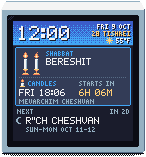

# JewCal

<figure class="hero" markdown="span">
  { .smalltv }
</figure>

**A pixel-art Jewish calendar for the [GeekMagic SmallTV](https://geekmagic.cc/products/).** It replaces the little desk display's firmware and shows,
for your city:

- **Shabbat and Yom Tov**, with candle-lighting and havdalah times. Two days of Yom Tov running into Shabbat are
  spelled out evening by evening.
- **Chol HaMoed and fasts**, with when each fast begins and ends.
- **Rosh Chodesh** and the weekly **parsha**, for Israel or the Diaspora.
- **The seasons:** Elul, the Ten Days of Return, the Omer count, the Three Weeks.
- **A screen for each holiday**, and the **weather**.

It runs on its own: the times come from [Hebcal.com](https://www.hebcal.com) over your WiFi, the screens rotate by
themselves, and nothing needs touching on Shabbat or Yom Tov. You set it up once from your phone, on a settings
page the device serves on your network, like the original firmware.

[Download JewCal](https://github.com/roma-glushko/geekmagic-jewcal/releases/latest){ .md-button .md-button--primary }
[All releases](https://github.com/roma-glushko/geekmagic-jewcal/releases){ .md-button }

## Which SmallTV do I have?

JewCal runs on two models, and each one has its own download. The two are not interchangeable.

| | [SmallTV **Ultra**](https://geekmagic.cc/products/smalltv-ultra/) | [SmallTV **Pro**](https://geekmagic.cc/products/smalltv-pro/) |
|---|---|---|
| How to tell | the stock web page shows **Model: SmallTV-Ultra**, firmware **Ultra-V9.x**; plain top | a touch-sensitive top |
| How JewCal is installed | over WiFi, in two uploads: no cable, no tools | over a USB cable |
| On a real device | Tested | not yet tested |
| Download | `jewcal-ultra-<version>.zip` | `jewcal-pro-<version>.zip` |

The stock firmware shows the device's address (like `192.168.0.87`) on its screen. Open that address in a browser
to see the model. GeekMagic's [model comparison](https://geekmagic.cc/compare/) has the hardware details.

!!! danger "Never upload one model's files to the other"
    The wrong file leaves the device unable to start. A SmallTV Ultra then needs its case opened and a serial adapter
    to recover. Some units have a different chip: newer plain "SmallTV" models (ESP32-C2) and newer Pro hardware
    (ESP32-S3). JewCal does not support them.

## Setup in three steps

1. **Install JewCal** on your [SmallTV Ultra](install-ultra.md) or [SmallTV Pro](install-pro.md). Download the zip for
   your model from the [latest release](https://github.com/roma-glushko/geekmagic-jewcal/releases/latest).
2. **Connect it to your WiFi.** A SmallTV Ultra usually keeps the network the original firmware used.
3. **Choose your city** on its settings page, at `http://jewcal.local/`.

Then see [what the screens show](screens.md) and [what you can change](settings.md).

!!! info "About the times"
    All times come from Hebcal for the location you choose: candle lighting, nightfall, fasts, the Israel or Diaspora
    schedule, and the parsha. Follow your community's customs, and ask your rabbi when in doubt.
