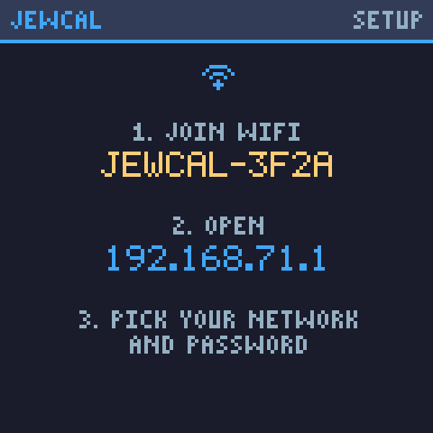
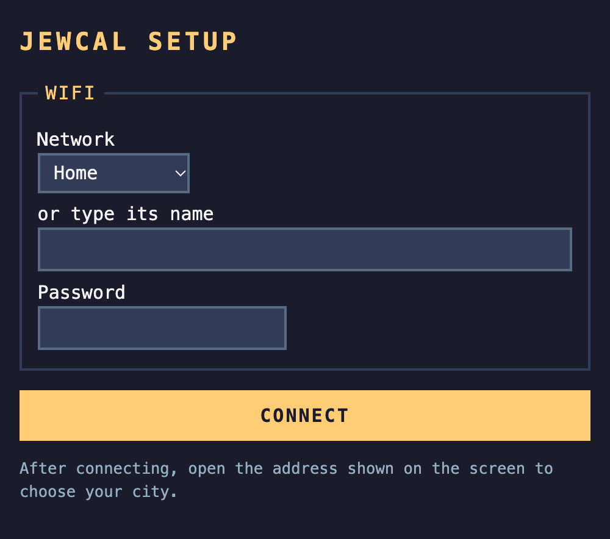

# Install on the SmallTV Ultra

Everything happens over WiFi from a browser: no cable, no tools, no opening the case. It takes about ten minutes.

The original firmware's update page only accepts small files, so JewCal goes on in **two uploads**: first a small
**installer**, then JewCal itself.

## Before you start

- The SmallTV Ultra is on your WiFi, showing the original (stock) firmware. Note the **address** on its screen, like
  `192.168.0.87`.
- A phone or computer on the same WiFi.
- From the [latest release](https://github.com/roma-glushko/geekmagic-jewcal/releases/latest), download
  **`jewcal-ultra-<version>.zip`** and unzip it. Inside are `jewcal-ultra-installer.bin`, `jewcal-ultra.bin` and
  instructions.

!!! warning "This replaces the original firmware"
    You can go back later: see [Back to the original firmware](#back-to-the-original-firmware). Photos you stored
    with the original firmware may be lost.

## 1. Upload the installer

1. In a browser, open **`http://<address>/update`**, using the address from the screen. This is the original
   firmware's *Firmware update* page.
2. Choose **`jewcal-ultra-installer.bin`** and upload it.
3. The SmallTV restarts and shows **JEWCAL INSTALLER**, with the address to open next.

??? question "The page says *Not Enough Space*"
    You picked `jewcal-ultra.bin`. The original firmware has no room for it: upload `jewcal-ultra-installer.bin`
    first. Nothing was written.

## 2. Upload JewCal

1. Open the address the installer shows. If it is on your network, that is the same address as before. Otherwise,
   join the WiFi network **`JEWCAL-INSTALL-XXXX`** and open **`http://192.168.4.1/`**.
2. In the **Firmware** box, choose **`jewcal-ultra.bin`** and press **Install**.
3. Wait about half a minute. The SmallTV restarts into JewCal.

## 3. Connect to your WiFi

JewCal joins the network the original firmware used, so usually there is nothing to do. If the screen shows
**SETUP** instead:

<figure markdown="span">
  { width="240" }
  <figcaption>The device asks you to join its network</figcaption>
</figure>
<figure markdown="span">
  { .page }
  <figcaption>Pick your network and enter its password</figcaption>
</figure>

1. On your phone, join the WiFi network **`JEWCAL-XXXX`** shown on the screen.
2. The setup page usually opens by itself. If not, open **`http://192.168.4.1/`**.
3. Pick your network, type its password, and press **Connect**. JewCal restarts and joins it.

!!! note
    The SmallTV only sees 2.4 GHz WiFi. A network that is 5 GHz only will not work.

## 4. Choose your city

1. Open **`http://jewcal.local/`**. Some Android phones cannot open `.local` addresses: use the address shown on
   JewCal's **info screen** instead, which appears at the end of every round of screens.
2. Under **Location**, type your city and pick it from the list.
3. Press **Save**. The calendar appears within a few seconds.

That's it. The [Settings](settings.md) page explains every option, and [The screens](screens.md) shows what each
screen means.

## Updating JewCal

1. Download the newer `jewcal-ultra-<version>.zip` from the
   [releases page](https://github.com/roma-glushko/geekmagic-jewcal/releases).
2. Open the settings page (`http://jewcal.local/`) and click **Update firmware** at the bottom.
3. In the **Firmware** box, upload `jewcal-ultra.bin`. Your city and settings are kept.

The update page's address changes every time JewCal restarts, so that other websites cannot reach it. Always open it
from the settings page.

## Back to the original firmware

GeekMagic publishes it at [github.com/GeekMagicClock/smalltv-ultra](https://github.com/GeekMagicClock/smalltv-ultra).
Download the latest `Ultra-V9…` zip, unzip it, and upload its `.bin` through **Update firmware** on JewCal's
settings page.
