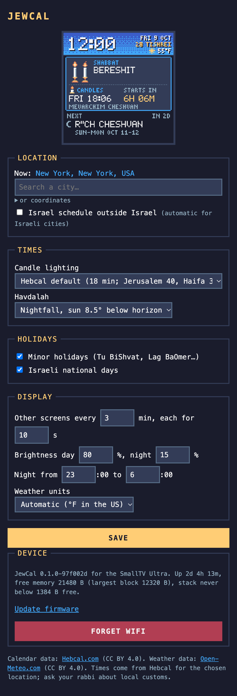

# Settings

JewCal is set up from a web page it serves on your network, much like the original firmware. Open it from any phone
or computer on the same WiFi:

- **`http://jewcal.local/`**
- or the address shown on JewCal's **info screen**, like `http://192.168.0.87/`. Use this on Android phones that
  cannot open `.local` addresses.

<figure markdown="span">
  { .page }
  <figcaption>The settings page on a phone (a SmallTV Ultra)</figcaption>
</figure>

At the top is a **live picture of the screen**, refreshed every few seconds. Change what you need and press **Save**:
the device applies it at once, and fetches a new calendar if the location or the times changed.

## Location

**Search a city.** Type at least two letters and pick your city from the list. **Now:** shows the location in use.

- On the **SmallTV Pro** the list comes from Hebcal's city search.
- On the **SmallTV Ultra** it comes from Open-Meteo's geocoder and lists towns of 1,000 people or more, the ones
  Hebcal knows. If yours is smaller, pick the nearest larger one, or use coordinates.

**Or coordinates.** Open *or coordinates* and type the latitude and longitude in decimal degrees: `31.7683` and
`35.2137` for Jerusalem, negative for south or west. The time zone is worked out from them. Hebcal's city-specific
customs, like Jerusalem's 40-minute candle lighting, only apply when you pick the city by name.

**Israel schedule outside Israel.** A city picked in Israel always gets the Israel schedule: one day of Yom Tov and
the Israeli parsha. Tick this box if you entered coordinates in Israel, or if you live elsewhere but keep the Israel
schedule.

## Times

**Candle lighting**, in minutes before sunset:

- **Hebcal default:** 18 minutes; in Israel 20, in Jerusalem 40, and in Haifa and Zikhron Ya'akov 30.
- Or a fixed 15, 18, 20, 22, 30 or 40 minutes.

**Havdalah**, the end of Shabbat and Yom Tov:

- **Nightfall:** when the sun is 8.5° below the horizon. This is Hebcal's default.
- Or a fixed 42, 50 or 72 minutes after sunset.

Minor fasts begin at dawn; Tisha B'Av and Yom Kippur begin the evening before. All end at nightfall, as Hebcal
publishes them.

## Holidays

- **Minor holidays:** Tu BiShvat, Lag BaOmer, Tu B'Av, Pesach Sheni and the like.
- **Israeli national days:** Yom HaShoah, Yom HaZikaron, Yom HaAtzma'ut, Yom Yerushalayim.

Major holidays, fasts and Rosh Chodesh are always shown.

## Display

**Other screens every … min, each for … s.** How often the other screens come round (1–60 minutes), and how long
each one stays (3–60 seconds). In between, the main screen is shown.

**Brightness day … %, night … %.** The backlight by day (5–100%) and at night (0–100%; 0 turns it off).

**Night from … to ….** When night brightness applies, in whole hours. Set both to the same hour to keep day
brightness all the time.

**Weather units:**

| Choice | Temperature | Wind | Pressure |
|---|---|---|---|
| Automatic | °F in the US, °C elsewhere | as below | as below |
| °C, km/h, hPa | °C | km/h | hPa |
| °C, m/s, mmHg | °C | m/s | mmHg |
| °F, mph, inHg | °F | mph | inHg |

Weather comes from [Open-Meteo](https://open-meteo.com) for your location and refreshes every half hour.

## Device (SmallTV Ultra)

The Ultra's page ends with a **Device** section:

- **A status line:** the firmware version, how long it has been running, free memory, and the last crash if there was
  one. It is useful when reporting a problem.
- **Update firmware:** opens the page for uploading a new `jewcal-ultra.bin` (see
  [Updating JewCal](install-ultra.md#updating-jewcal)).
- **Forget WiFi:** erases the saved network and restarts into SETUP, to move the device to another network. The
  Ultra has no button, so this is the way to do it.

On the **SmallTV Pro**, hold the top of the case for 8 seconds instead to forget the WiFi network.
